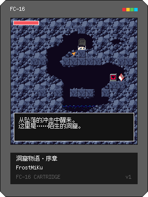

# 洞窟物语·序章（Cave Story: Prologue）— FC-16 截面移植

把 2004 年 Studio Pixel 的《洞窟物语》开局截面移植到 FC-16 幻想主机的演示卡带。
FC-16 平台代码保持原样；卡带、转换工具和数据全部位于本文件夹内。



## 运行

```bash
# 桌面直接游玩
../FC-16/target/debug/fc16 cave-story/cave-story.fc16.png

# headless 验证（截图 + 音频）
../FC-16/target/debug/fc16 cave-story/cave-story.fc16.png \
  --frames 900 --screenshot out.png --wav out.wav
```

操作：方向键/左摇杆移动，A(J) 跳，B(K) 射击，↑ 与 NPC/门/宝箱/存档点交互。
按住 ↑ 走到门前即可进门；存档点处 A=记录、B=取消。有存档时启动自动续玩，**按住 B 启动则重开新游戏**。

## 截面内容

原版开局的前 15 分钟，演出替换为短对白：

| 关卡 | 原版编号 | 内容 |
|---|---|---|
| 出生洞窟 | 13 | 醒来演出、门 → 初始洞窟 |
| 初始洞窟 | 12 | 跳跳虫/蝙蝠战斗、尖刺、存档牌、贴顶跳越障、眼之门 → 村庄、暗门 → 亚瑟之家 |
| 咪咪村庄 | 11 | 金/多隆子/苏/马欣/壶/路牌（文本改编自原版汉化）、宝箱=地图系统、存档点、墓场锁门 |
| 亚瑟的之家 | 90 | 宝箱=**北极星**、隐者枪匠对白、墓碑 |

系统：原版整数物理（0x200 子像素、跳跃 -0x500、重力 0x50/0x20）、北极星三级（伤害 1/2/4、
经验表 10/20）、经验水晶掉落与磁吸、接触伤害/无敌帧/死亡重生、TSC 子集解释器
（MSG/NOD/CLR/TRA/FL±/FLJ/IT+/AM+/CNP/DNP/SOU/EVE…）、Q16.16 之外全整数运算保证确定性。

## 文件结构

```
cave-story.fc16.png   发布卡带（300×400 封面即卡带本体）
cave-story.fc16       纯文本开发格式
project/              Lua 源码（构建时按序合并为单 chunk）
  10_data.lua         CS_PAL 调色板（SPEC §2.2）
  12_const.lua        原版物理/武器常数
  14_util.lua         标志位、显示期调色淡出（pal(c,dark,1)）
  20_tsc.lua          迷你 TSC 解释器
  30_player.lua       玩家：移动/跳跃/射击/斜坡/交互
  40_npc.lua          实体：布点/碰撞/AI（跳跳虫、蝙蝠、水晶、烟雾）/子弹/特效
  50_game.lua         关卡切换、相机、HUD、对话框、存档
  60_scripts.lua      截面事件脚本（TSC 语法，十进制参数）
  99_main.lua         _init/_update/_draw
build/                构建产物：sprites/maps/sflags/sfx/waveforms/custom 六段 + cart.lua
tools/cs_build.py     资产转换器：BMP(1/2/4/8bpp)→64 色量化装箱（精灵段为瓦片优先
                      布局：瓦片 t 连续占 t*256B，瓦片内行优先——SPEC §4.1）、
                      PXM→地图平面、PXE→布点（含截面裁剪/凿孔改图）、
                      pxa→sflags(实心/斜坡/尖刺位)、npc.tbl→属性表、SFX 合成（144B/条）
tools/cs_luabuild.py  合并 project/*.lua → build/cart.lua（内联 CS 数据表）
tools/cs_extract.py   从 Doukutsu.exe 提取原版 stage 表（gTMT 特征扫描）
tools/cs_save.py      生成测试注入存档（--save，§13 结构化 JSON）
tools/cs_survey.py    TSC 解密（中位字节减法密码）/PXM/PXE 普查
tools/cs_tscdump.py   TSC 按事件分组阅读器
assets/               转换中间数据（stage_table.json、npc_rects.json）与预览图
```

## 重新构建

```bash
python3 tools/build_all.py cave-story
../FC-16/target/debug/fc16 cave-story/cave-story.fc16
```

## Headless 回归脚本

场景存档可用 `tools/cs_save.py` 按当前 JSON 字段生成，再通过宿主 `--save` 参数注入。

- `build/play10.txt` — 全流程：出生洞窟 → 初始洞窟（贴顶跳）→ 眼之门 → 咪咪村庄
- `build/t_chest.txt` — 宝箱/道具/旗标
- `build/t_pole.txt` — 北极星入手与射击
- `build/t_fight.txt` — 击杀跳跳虫 → 经验 → HUD 经验条
- `build/t_save.txt` — 存档点写入

## 已知裁剪与后续候选

- 原版开场演出（避难所救数马、布斯特博士、仓库事件）未包含，NPC 以短对白呈现
- Balrog Boss 战、Organya 音乐未包含；SFX 为 16 条手工芯片音
- 眼之门秘室左侧岩壁被凿开（原版仅能从村庄侧进入），保证无武器路线可通行
- 眼之门秘室内 3 只跳跳虫移除（无武器无法击杀，会堵死路线）

## 版权说明

引擎参考 doukutsu-rs（MIT）。《洞窟物语》原版游戏 © Studio Pixel／Nicalis。
本演示为非商业粉丝移植，仅供学习交流；原版数据（美术/文本改编来源）归原作者所有。


元数据、代码和资源路径以 [fc16.project.json](fc16.project.json) 为准。
