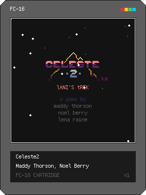

# Celeste2（Celeste Classic 2 · FC-16 原生移植）

把 Maddy Thorson / Noel Berry / Lena Raine 在 Celeste 三周年时用 3 天做出的 PICO-8
游戏 [Celeste Classic 2](https://www.lexaloffle.com/bbs/?tid=40582)（原卡带名
*Celeste 2: lANI'S tREK*）完整移植到 FC-16：8 个关卡、抓钩、雪球、弹簧板、碎裂砖、
草莓与计时结算全部保留。

**这是原生移植，不是兼容层**：源码直接用 FC-16 的 `spr/mget/fget/sfx/music/fillp/…`
重写，机器专用地址、PICO-8 专属语法（`!=`、`\`、`>>>`、goto、`%addr` 取字节）与
px9 解压运行时全部消失；卡带里没有一行用于解释 PICO-8 语义的包装函数。



## 运行

```bash
../FC-16/target/debug/fc16 celeste2/celeste2.fc16
# headless 验证（截图 + 音频）
../FC-16/target/debug/fc16 celeste2/celeste2.fc16 --frames 600 \
  --screenshot out.png --wav out.wav
```

| 按键 | 作用 |
|---|---|
| 方向（D-pad / 左摇杆） | 移动；↓ 加速下落、把抓取物向下掷出 |
| A (J) | 跳跃：可变高度、土狼时间、贴墙蹬、钩索跳 |
| B (K) | 抛出 / 收回钩索（拾取钩索后可用） |

标题画面按 A 或 B 开始；关卡标题卡后进入关卡。暂停/返回由宿主处理。

首次游玩从标题开始。进入新关卡或碰到记录点时，卡带立即保存当前关卡、记录点、
已收集的草莓、死亡数和计时；下次启动直接从该位置继续。关卡中途退出会回到最近的
记录点；尚无记录点的关卡会回到该关入口。存档由 FC-16 宿主按卡带 `saveId` 保存。

## 与 PICO-8 原作的映射

原作 `_update()`/`_draw()` 是 **30Hz**，FC-16 固定 60Hz 且屏幕与瓦片尺寸都是 2 倍
（128×128 / 8×8 → 256×256 / 16×16）。两条缩放正好互为倒数，于是：

| 量 | 处理 | 结果 |
|---|---|---|
| 位置、尺寸、距离、试探长度 | ×2 | 世界坐标落在 256×256 的 FC 像素域 |
| 速度（px/帧） | 原值 | 2 倍尺度 ÷ 2 倍帧率相消，落在同一物理速度 |
| 加速度（px/帧²） | ÷2 | 60Hz 下每帧速度增量减半；自由跳跃位移另补半步重力，保持原作先加速后移动的积分 |
| 起跳/弹跳的瞬时水平冲量 | 原值 | 普通起跳 `0.2`、雪球弹跳 `0.5`，不按逐帧加速度缩小 |
| 分数量逐帧速率（sprite 动画累加、摆动衰减） | ÷2 | 保持每秒变化量 |
| 帧计数计时器（土狼时间 4→8、冻结 2→4、无敌锁 120→240…） | 按生效阶段换算 | 持续时间翻倍；移动前起跳的保持窗口包含起跳帧，因此 `4→9`、弹簧 `6→13`；移动后雪球弹跳为 `4→8` |
| 指数平滑（围巾、草莓吸附 `/1.5`、`/2`、`/8`） | `k60 = 1−√(1−k30)` | 保持时间常数 |
| `sin(time()…)` 动画 | 原值 | `time()` 两平台都是秒 |

美术：PICO-8 128×128 精灵表逐点 **2× 最近邻**写入 FC-16 256×2048 瓦片表，
瓦片号与原作一致（`spr(n)` 对 `spr(n)`），因此 `sspr` 标题画面、精灵翻转、
`pal()` 重映射全部按号对齐。

`rect/rectfill` 由「右下端点」改为「宽高」：先按原作端点算出包含端点的宽高，
再整体 ×2（不是把端点各自乘 2）。文本改用固件单一字体的 `print`/`textw`
（`print_center` 由 `#text*4` 改为 `textw(text)`），字号 1× 在 256 屏上与原作 6px
字在 128 屏上的相对大小一致。

### 调色板定标

`tools/cs2_convert.py` 用 `assets/palette.dat` 计算 PICO-8 16 色到 FC-16 固定 64 色的
CIEDE2000 最近色，色号 0–15 一次定死（源码里经 `CLR[]` 表读取，`pal()` 的绘制期
重映射也走同一张表）：

| PICO | 0 | 1 | 2 | 3 | 4 | 5 | 6 | 7 | 8 | 9 | 10 | 11 | 12 | 13 | 14 | 15 |
|---|---|---|---|---|---|---|---|---|---|---|---|---|---|---|---|---|
| FC-16 | 0 | 12 | 53 | 35 | **18** | 4 | 6 | **7** | 63 | 29 | 31 | 34 | 41 | 10 | 57 | 21 |

两处人工覆盖最近色计算：**白 7 保留为 FC 7**（最近色会落到偏黄的 22 号，
文字与高光必须仍是白），**棕 4 取 FC 18**（保留棕色色相，最近色 25 号偏红会与
8 号红混淆）。色 0 两平台都是精灵透明色，映射到 FC 0 后透明语义不变。

### 关卡数据

原作把每关用 px9 压缩后塞进 `celeste2` 卡带的共享区，运行时解压进 RAM。
FC-16 的自定义数据段有 236640B（SPEC §4.2），压缩毫无意义，因此关卡以
**解压后的地图格**烘焙进 `custom.bin`（每格 2B 小端，瓦片号在低 11 位），
`goto_level()` 用 `memcpy` 逐行搬进地图平面 0，`tile_at()` 直接用 `mget`，
碰撞用 `fget(tile,1)`——PICO-8 的 `peek(0x4300+…)` 与 px9_decomp 整体删除。

数据来源是各关卡开发卡带（`../Celeste2/1.p8`…`8.p8`）：`__map__` 为地图行 0–31，
高度 > 32 的第 8 关后 30 行位于卡带 ROM 0x1000 共享区（`.p8` 文本里是 `__gfx__`
第 64 行起，每地图行 128 字节）。**校验方式**：用 Python 重写 px9 压缩器重新压缩
提取出的关卡，7 个已知偏移的压缩长度与原 `_packer` 记录的偏移差逐一相等
（343/336/634/1098/234/235/199 字节），确认提取与位序完全正确。

### 音频

| PICO-8 | FC-16 | 说明 |
|---|---|---|
| SFX 速度 N tick | `SPD = N×2` audio ticks/步，u16 小端 | PICO 120Hz，FC 240Hz；原作 130 tick 对应 260 FC ticks |
| 音高 0–63 | `note = pitch + 24` | PICO C0=65.4Hz 在 FC 记作 C2（note 24）；音量 0 才静音 |
| 音量 0–7 | `(15×vol+3)//7`（0–15） | 0 与满音量分别精确映射到 0 与 15 |
| 效果 0–7 | 原值 | 滑音/颤音/降音/淡入/淡出/快慢琶音逐音符对齐 |
| 循环起止 | START 原值，END 为原 exclusive end-1 | START=END 可单步循环 |

PICO-8 波形 0–7 对应 FC 同号系统波形。原作的 8–15 是引用前八条 SFX 的
**SFX Instrument**，并非从音量画出的波形。转换器将原 SFX 0–7 各自复制成独立
Custom Instrument 0–7，保留内部的 32 步、SPD、循环、逐步音高/波形/音量/效果；
原 SFX 8–63 的外层声音来源 8–15 则改指向 FC Instrument 0–7（来源编号 16–23）。
Instrument 内部音高维持原值，以 C2 为基准；外层音高加 24，使两层音高按
`outer + inner - C2` 合成。原卡带未用 Waveform Instrument 模式，因此八张 FC 自定义
Waveform 保持空白，不伪造音色。原卡带所有八份关卡卡带的 SFX/Music 段与主卡带相同。

| PICO 声音来源 | 0–7 | 8–15 |
|---|---|---|
| FC-16 声音来源 | 系统波形 0–7 | Custom Instrument 0–7（编码 16–23） |

乐谱：原作每行映射为 FC Music Row，PICO 四轨落在 FC 轨道 0–3，
各自保持完整 SFX SPD/LEN/LOOP；2–21 与 24–35 段按原 LOOP_START/LOOP_BACK
循环。原作 36/37/38 行的标志都为 `03`，三行分别自循环，由游戏显式 `music()` 切换。
Row 38 仅有一条循环 SFX，另在原本空闲的 channel 0 配置静音 SFX64（SPD260/LEN32），
使该行按原始 8320 tick 周期完成并回到自身；39/41 行带 STOP。音效沿用原作的
`sfx(n, 3, off, len)` 通道 3，与音乐共享同一抢占语义。

| 原 Music Row | 每行实际时长（FC audio tick） |
|---|---:|
| 0–35 | 704 |
| 36–38 | 8320 |
| 39 | 704 |
| 40 | 896 |
| 41 | 1024 |

转换的逐字段校验覆盖 64×32 个原始 SFX step、前八条 Instrument step、全部
42 行 Music 的四条原轨、流程标志和时长，也校验生成文件与转换器输出一致。
在仓库根目录运行：

```bash
python3 -m unittest discover -s celeste2/tools -p 'test_cs2_audio*.py'
```

其中原卡带逐字段校验需要并列的 `../Celeste2`；`test_cs2_audio_fixture.py` 使用
内置小样本，可单独运行以检查短 SFX、包含端点的 loop、双层音高和音量映射。
原作和 FC-16 的合成器实现不同，此校验确认资源语义和编排映射，不以此声称听觉或
PCM 逐样本相同。

### 判定与渲染细节

- `fillp`：两平台都是 bit15 左上、行优先，但 PICO 的位 1 透明位置对应 FC-16 的
  位 0 透明，因此逐位反转为 `0xf7fd` / `0x5a5a` / `0xa5a5`。透明位置真正保留
  已绘制的云、瓦片和精灵。移植将 128×128 几何放大到 256×256，仍使用 FC-16
  固定的屏幕 4×4 图案，因此抖动粒度不是像素等比复刻。
- 关卡进出场的逐行遮罩按原作 128 行各放大成 2 行，水平位移只放大一次，
  再由 FC-16 `rectfill` 的宽度参数覆盖到屏幕边缘；所有关卡共用这一转场。
- 原作单参数 `max(x)` 等价于 `max(0,x)`；FC-16 的 `math.max` 只在给出第二个参数时
  才会钳到 0。摄像机边界和倒计时均显式传入 0，避免关卡开头把视口移出地图。
- 抓钩每帧推进：原作每帧最多 6 步 × 2px，60Hz 下改为每帧最多 3 步 × 4px，
  射线粒度与行程不变。
- `check_solid`/`overlaps` 的试探偏移（`0,1`、`±2`、`0,-2`…）按 2 倍尺度换算，
  命中盒尺寸同为 2 倍，因此相对几何与原作逐像素等价。
- 抓钩跨越锚点、抓取物跨过玩家以及雪球弹跳的方向，显式按“左侧/中心及右侧”
  划分，保留原作边界归属；不依赖两平台不同的 `sgn(0)`，不改变核心数学API。

## 文件结构

```
celeste2.fc16.png    发布卡带（300×400 封面即卡带本体）
celeste2.fc16        纯文本开发格式
fc16.project.json    项目清单：卡带头参数与七个数据段
main.lua             入口：require 组装 + 60Hz 帧循环 + 标题/标题卡/关卡绘制
  data.lua           调色板表、关卡表、摄像机行为、关卡数据装载
  object.lua         实体基类、创建、逐像素移动与碰撞
  objects.lua        实体类型（雪球/弹簧板/碎裂砖/草莓/存档点/尖刺/生成器…）
  player.lua         玩家：状态机 0/1/2/10/11/12/50/99/100、抓钩、围巾演出
  input.lua          输入缓冲（方向合并、跳跃/钩索按下窗口）
  game.lua           关卡切换、工具函数、云/雪/正弦绳索绘制
tools/cs2_convert.py 资产转换器：精灵 2× 放大 + 调色板定标 + SFX/Instrument/Music/关卡重编码
tools/test_cs2_audio*.py  原卡带逐字段与内置样本校验
build/               转换产物：sprites/sflags/sfx/waveforms/instruments/music/custom/icon
assets/sheet.png     精灵表预览（--preview 生成）
```

## 重新构建

普通构建使用已提交素材，不需要原作仓库。

重新转换原版素材时，原作仓库需与本仓库并列（`../Celeste2`，含 `celeste2.p8` 与 `1.p8`…`8.p8`）：

```bash
python3 tools/build_all.py celeste2
../FC-16/target/debug/fc16 celeste2/celeste2.fc16
```

## 跳跃验收

普通跳、蹬墙跳、钩索跳、弹簧跳、雪球弹跳的最大上升分别为 **56 / 38 / 38 / 96 / 48px**。
按住2/4/6/8/10个60Hz更新的普通跳高度为24/32/40/48/56px。
回归测试使用原版玩家源码获得的等时输入高度基准，覆盖五种起跳的35组保持时长；
另验证一次性水平冲量、实心顶板取消保持与第二关冰柱房从右侧平台到左侧记录点的真实输入通行。
雪球被踩踏后的上弹只发生一次，投掷和生成器雪球首次落地最多反弹一次，随后沿水平方向滚动；拾取重投可以再次反弹，直接放下不会反弹。

```bash
cargo test -p fc16-core --test celeste2_test
```

第二关冰柱房的一条可行路线：从右侧平台向左落下，按住B钩住左下圆环，经过圆环时按A作钩索跳，
从中间冰柱底下钻入左侧窄缝，再交替蹬墙上到绿旗平台。无需修改地图或玩家能力。

## 其余移植差异

- 第 8 关地图里有 34 格瓦片号 ≥128，原作的精灵标志区对 128 号以上没有标志，
  这些格子既不绘制也不实心——移植保持同样数据与标志，行为与原作一致。
- 原作 `standalone` 分支（从标题画面 `load()` 下一张卡带）与 `_packer`/
  `_updater` 开发工具不移植：全部关卡已烘焙进一张卡带。
- 原作的调试用 `stat()`/`peek2(0x5f28)` 摄像机读取、`px9_decomp`、`score` 空赋值
  等已随 API 替换删除。
- 震屏基准：原作从硬件摄像机寄存器读取当前值，冻结帧（死亡 4 帧）里会以上一帧的
  抖动值为基准做随机游走；移植始终以 `camera_x/camera_y`（未抖动值）为基准，
  抖动区间同为 ±4px。

## 版权说明

Celeste Classic 2 由 Maddy Thorson、Noel Berry 制作，音乐由 Lena Raine 创作
（MIT 授权的 PICO-8 卡带源码）。本移植为非商业粉丝移植，仅供学习交流；
原作美术、关卡、音频数据版权归原作者所有。


元数据、代码和资源路径以 [fc16.project.json](fc16.project.json) 为准。
